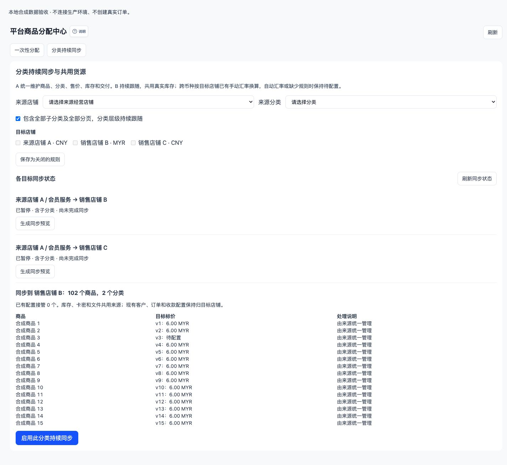
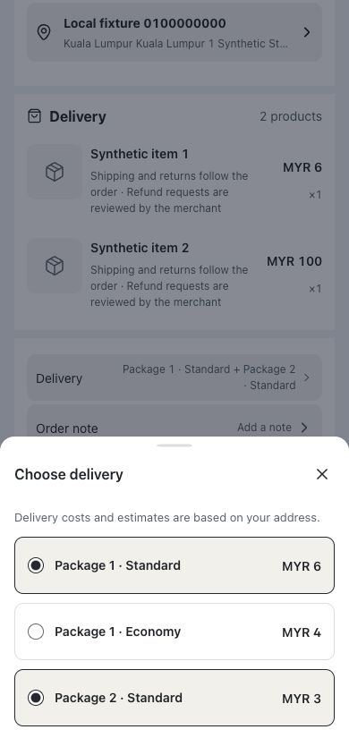
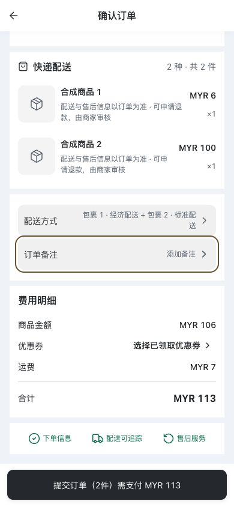

# 分类持续同步与共用货源：开发与发布记录

## 2026-10-16 发布接续

用户已授权继续到上线。已快进接入主线 `3dfcf5ef84c2cb24113c105d36e56c77b5867f72`，当前已完成本地发布前验证，尚未推送、合并或部署。实际阶段以 `release-execution/RELEASE_LEDGER.json` 为准；下文原始本地交付记录保留当时状态。

- MySQL 扩展验收 18 个场景通过；强杀测试进程并等待真实租约到期的三个必要场景另行复验通过。见 `closeout-mysql-after-interruption.log`、`sigkill-mysql-final.log`。初次强杀注入 SQL 未引用保留字，失败记录保留，修正没有放宽业务断言。
- SQL.js 和 MySQL 均通过真实采购入库、批次、目标店结账自动拆零及来源批次扣减；B 不复制库存。文件服务上传后真实 HTTP 下载通过，成交后保留原版本、错误店铺域名返回 404、B 私有文件库拒绝。浏览器文件选择上传未执行。
- 原生五分钟调度实测不手动入队，在 128185 毫秒后纠正故意漏发事件的目标价格，见 `scheduled-reconciliation-mysql.json`。该时长受当时调度相位影响，不是生产 SLA。
- 已修复后台授权记录为空时的异常，13 项商品编辑能力回归通过；商城最后 188 项相关测试及构建通过，828 项其他关联测试按输入不变复用。仅旧接口回退所需的配送准备按需加载，入口和首屏资源预算未修改。
- 本地标准数据库与浏览器扩展回归完成。真实付款、外部邮件和生产同步启用不在本次执行范围内。
- 标准 Core MySQL 2065 项已分组验证（1858 项首轮通过，两个初始化超时文件的 207 项隔离复验通过）；后台浏览器 317 项通过、4 项跳过，四个 Storybook 浏览器分片通过；PostgreSQL 翻译 35 项及迁移验证通过。购物车及五个原生插件 136 项也已通过；分组累计覆盖 2201 项。
- 当前源码的万件容量复验：SQL.js 合成 10000 商品，预览 11.22 秒，首次完整同步 127.03 秒，102 个游标点。初次导入独立记录，不冒充 60 秒增量变更目标或生产容量。

- 发布前补验发现并修复：来源所有配送金额均无法换算时，目标待配置商品仍可被内部解析取得货源。统一货源入口现复核目标授权状态、规格范围和待配置列表；最终 16 项分类同步业务回归通过，包含阻断及配置恢复。

## 原始本地交付快照

本地代码已实现：在平台商品分配中心选择 A 的分类及 B/C，预览后按目标启用；整类已有商品分批上架，后续商品、规格、分类和经营配置继续跟随 A。规则默认关闭。本轮未提交、推送、合并、部署或执行生产同步。

## 候选身份

- 所属项目：Vendure / kaiyuangouwu。
- 基线：`5d97c5f169bbab000f95eb08e7cdc04a94b36076`。
- 分支：`codex/catalog-continuous-sync-20261015`。
- 独立工作区：`vendure-master/.codex-worktrees/catalog-continuous-sync-20261015`。主工作区和其他任务改动未带入。
- 实际收尾日期：2026-10-16（Asia/Kuala_Lumpur）；目录沿用任务开始日期。
- 代码与锁文件校验见 `source-manifest.json`。当前是未提交工作树，不能把基线 SHA 当成已经包含本功能的发布 SHA。

## 已实现的行为

1. 保留一次性分配，增加分类持续同步面板。可一次保存多个目标、预览数量与价格、确认接管差异、分别启用/暂停、查看失败项和继续对账。
2. 同一 Product/Variant 沿用，B 建立独立受管分类映射。分类按 ID 跟随，包含子分类和全部分页；退出范围只处理规则管理的资源。
3. B 的经营标价沿用来源标价；跨币种使用 B 已有手动 CNY/MYR 比例、舍入及加价配置。买家切换展示币种继续使用现有换算，不能跳过 B 的经营换算。缺少规则或交付前提时待配置，不能按伪造零价购买。
4. 来源解析贯通库存展示、购物车检查、预占、销售扣减、释放和回库。原始卡池、数字额度、文件版本、包装和实物库存继续归 A，不复制库存数值到 B。
5. B 的订单保留销售店铺身份，并保存原始供货店铺与规则/报价依据。成交后的价格和文件版本使用已有订单及预占记录；暂停规则不改写历史履约。
6. 混合货源在一个订单中按包裹分别选择配送方式、计算运费与门槛，前台展示合计。退货仓库只提供该订单行原始货源下的可用库存位置，验收回原货源，避免开放整个来源仓库管理面。
7. 受管商品的独立经营设置不可修改；B 的客户、订单、收款、优惠券及税务仍由 B 管理。共享商品资料与图片不赋予 B 管理来源素材库的权限。
8. 提交后事件进入现有 Worker；每页最多 100 个商品，指纹去重、租约、版本检查、游标和固定事件水位支持恢复；五分钟补偿扫描处理漏事件及目标价格/规格投影漂移。

## 主要文件

| 范围 | 实现入口 |
| --- | --- |
| 规则、映射、订单来源记录 | `packages/core/src/entity/catalog-governance/catalog-sync.entity.ts` |
| 加法迁移 | `packages/dev-server/migrations/1792022400000-add-catalog-continuous-sync.ts` |
| 分类扫描、接管与撤销基线 | `packages/catalog-management-plugin/src/catalog-sync.service.ts` |
| 事件、Worker 和补偿 | `packages/catalog-management-plugin/src/catalog-sync-queue.service.ts` |
| Admin 接口与授权 | `packages/catalog-management-plugin/src/catalog-sync.resolver.ts` |
| 来源解析、历史来源、价格 | `packages/store-management-plugin/src/catalog-sync-source.service.ts` |
| 交付接入与分包配送 | `packages/commerce-fulfillment-plugin/src/catalog-sync-supply.service.ts`、`catalog-sync-shipping.service.ts` |
| 原库存与履约路径 | packaging-stock-location-strategy、product-packaging、digital-product、digital-delivery、checkout-resources、after-sales、physical-return 服务 |
| 平台后台面板 | `packages/next-admin/src/pages/Catalog/CatalogContinuousSyncPanel.tsx` |
| 多配送购物车与结账 | storefront-cart 插件、storefront API/controller、`checkout-page.tsx` |
| 真实数据库验收 | `packages/store-management-plugin/e2e/catalog-sync-acceptance.ts`、`catalog-sync-physical-acceptance.ts`、`catalog-sync-scale-acceptance.ts` |

完整变更文件及哈希见 `source-manifest.json`，没有新增运行依赖或环境变量。

## 实际验证

- SQL.js 与隔离 MySQL：首轮各 13 项全部通过；新增租约恢复后各 14 项通过，新增分类演进夹具出现不符合原有服务契约的问题，修正后仅复验该项及其两个必要前置，两种数据库均 3 项通过。合计覆盖 15 个不同业务场景，分组复验结果不冒充一次 15 项全部通过的执行。各次结果和保留失败证据见 `final-*-e2e.log`、`extended-*-e2e*.log`、`category-evolution-*-final.log`。跳过项为本次筛选之外的历史用例和单独运行的万件测试，不能计作本轮通过。
- 汇率策略 10 项通过；履约最后一组 4 个文件 96 项通过；库存、包装、数字额度相关早先定向结果按输入不变复用。
- 商城 API、购物车控制器和结账组早先 245 项通过；新增分包选择用例后 CheckoutPage 45 项通过。后台持续同步/分配中心/售后三文件 17 项通过，商品编辑草稿 9 项通过。
- 迁移 SQL.js 单元 1 项通过；隔离 MySQL 在 ORM 启动前执行真实迁移及重复 up，验证默认关闭；迁移登记检查通过（157 个活动迁移）。
- core、store-management、catalog-management、storefront-cart 构建通过并复用；最后的 commerce-fulfillment、next-admin、storefront 完整构建通过，日志保存在本目录。后台反馈门禁和 717 源文件显示文案检查通过。
- 浏览器：后台桌面 1440×900 与手机 390×844；商城中英文，桌面及手机。验证保存默认关闭、预览、启用后的“等待同步”，以及切换包裹 1 的配送后包裹 2 保持原选择，运费与合计更新。手机未发现横向溢出。

性能数据：`scale-10000.json` 已由最新源码复验更新，本地 SQL.js 合成 10000 个真实商品，预览约 11.22 秒，首次 Worker 同步约 127.03 秒（原始较早源码测量为 7.59 秒 / 46.85 秒，不再作为当前容量结论）。事件耗时及补偿入队后的耗时见 `event-latency-*.json`，均低于 60 秒目标；五分钟间隔为调度配置，没有把手动调用补偿扫描描述成等待五分钟的实测。单次本地数据不代表生产 SLA。

## 接口和管理边界

现有平台商品管理权限控制这些 Admin 根字段：`catalogSyncRules`、`catalogSyncIssues`、`previewCatalogSyncRule`、`saveCatalogSyncRule`、`enableCatalogSyncRule`、`pauseCatalogSyncRule`、`reconcileCatalogSyncRule`。没有公开写入接口。保存默认为关闭，启用需要当前版本、最新预览指纹和必要接管确认。

仅直接经营店铺可做来源；循环、转授权链、多个来源争抢配置、未结目标库存占用和不兼容交付会阻止接管。自定义配送计算器不在首版继承范围内，会在预览阻塞，不能默默套用错误运费。

## 验收边界和后续

当前状态：**代码已实现；本地发布前验证完成；尚未发布。** 逐项见 [覆盖台账](COVERAGE.md) 及 `release-execution/RELEASE_LEDGER.json`。文件服务上传与真实 HTTP 下载、采购批次与包装拆零、隔离租约持有进程强杀恢复、真实五分钟调度已补验。浏览器文件选择上传、生产容量及实际生产同步仍未执行。真实付款和外部邮件未执行。

迁移、暂停及兼容恢复步骤见 [迁移说明](MIGRATION.md)。后续生产启用需单独授权；已经接单后不能回退到不识别来源快照的旧后端。

## 页面证据

以下截图只代表本地业务组件与合成数据操作，不代表已在真实店铺启用。

